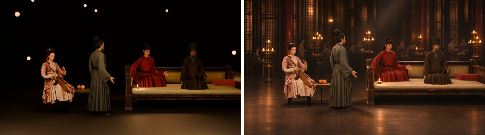

# 入画 · 听乐

> 你是韩熙载。今夜府中设宴，宫里来了一位画师——他在看你。

**在线体验 → https://yeje-cpu.github.io/ruhua-tingyue/**（建议电脑 Chrome，开声音，允许麦克风）

## 这是什么
《韩熙载夜宴图》"听乐"一幕的**第一人称互动影片**。

传说南唐后主派画师顾闳中潜入韩府夜宴，回去凭记忆画下这幅画。这一次，你坐在韩熙载的位置上：

- 画师走近，盯着你问："大人今夜……怎么闷闷不乐？"——**拍手、叫好**，装得尽兴些，他才会放松；
- 李姬弹起琵琶——**跟着打拍子**，你的拍子就是琴的快慢（慢板 / 中板 / 急板）；一停手，画师就回头看你；
- 曲终，画师作揖："下官……都记下了。"镜头第一次转过来，你看见了自己——然后，一切回到画里。

## 怎么玩
- 点"入画"，全程约 1 分半；左上角会一直提示你现在该做什么
- 开麦克风：对着电脑**拍手 / 欢呼**（只认拍手和响亮的欢呼，说话不算）
- 不开麦：按**空格**或点屏幕
- 右上角：倍速（默认"自动"，过场稍快、互动段正常速度；打拍子不受影响）、静音

## 怎么做的
| 环节 | 工具 |
|---|---|
| 人物与道具 3D 模型 | **Hi3D**（顾闳中、李姬、郎粲、韩熙载、琵琶、床榻、果盘） |
| 绑骨、按原画摆站位、路径追踪渲染全景 | 本机 Blender（Hi3D 本地技能脚本思路，零积分） |
| 以 3D 构图为底座生成 CG 全景与各镜首帧 | Codex 图像生成 |
| 首尾帧串联，生成一条连续镜头 | LibTV · Seedance 2.5 |
| 互动（拍手检测、拍速控琴速、分支） | 网页（原生 JS + Web Audio） |

3D 在这里干的事：把人物站位和原画"钉死"——谁坐左、谁坐右、谁朝向谁——让 AI 视频照着拍，不乱摆人。

## 致谢
- 原画：五代 · 顾闳中《韩熙载夜宴图》（宋摹本，故宫博物院藏）
- 画面质感参考：抖音上一条 2 万赞的 AIGC 听乐短片
- Hi3D 黑客松（2026-11-08）

一天之内，从"3D 手办像陶俑"到"终于像一场夜宴"，推翻了很多版。赛后又翻修了一轮：画面更清楚了，补上了背景介绍和一路的操作提示，让没听过路演的人也能自己玩下去。它仍不完美（个别拼接还有跳动），但它是我们真心想让人"坐进画里"的一次尝试。

比赛当天的原版保留在标签 `v1-hackathon`。
